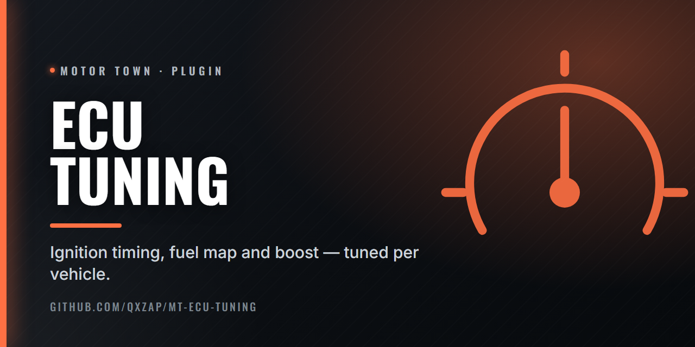

  

# ECU Tuning

Plugin that adds an ECU Tuning section to the garage's Tuning screen, set per vehicle.

- **Ignition timing, fuel map, boost pressure:** power, against heat and fuel use, and they shape how the exhaust behaves. 0.50 is stock.
- **Cooling boost:** up to three times the radiator's cooling.
- **Anti-lag** on turbo cars: above the RPM you set, after a lift, the turbo stays spun up for a moment. Touching the brake cancels it.
- **Pops and bangs** with their own kinds, chance and timing, after a lift. A rich or retarded map fires more often and for longer.
- **Exhaust flames** from the real exhaust sockets, with colour shift and light on the surroundings.
- **Turbo flutter** on lift from above half revs, on engines that rev to 4000 or more. Bigger turbos are louder.
- **DPF delete** on diesels: heavier, longer smoke.
- **Supercharger whine** for supercharger intakes.

Rows follow the engine fitted: electric cars get no section, and turbo, diesel and backfire rows only show where they apply.

The engine rows take effect in single player or as host only. Pops, flames and sounds work anywhere.

## Install

Needs [Plugin Loader](https://github.com/qxZap/mt-plugin-loader) (`version.dll`) in
`MotorTown\Binaries\Win64\`. Put `mt_plugin_ECUTuning.dll` in `MotorTown\Binaries\Win64\plugins\`.

Nothing else is required. With MoreTuning you also get turbo flutter and supercharger intakes, and with Teh's Engine Sound Pack the supercharger whine. If a sound is not there, that effect just stays silent.

## Build

`build.bat` (MSVC 2022, x64) writes `out\mt_plugin_ECUTuning.dll`.
